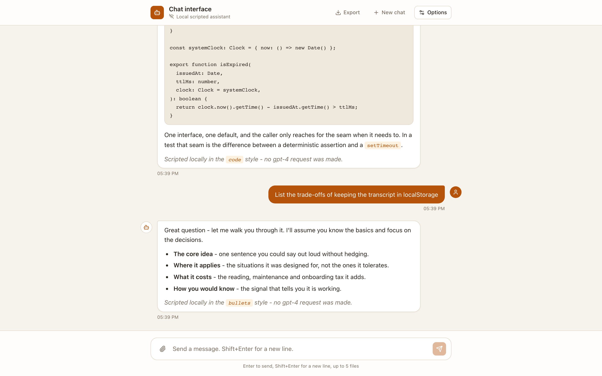
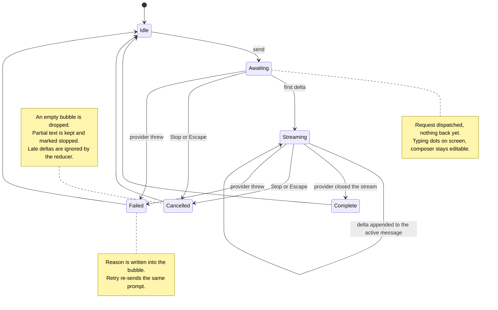
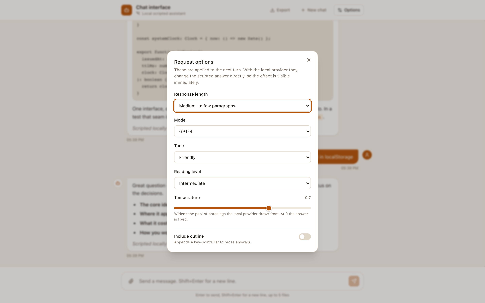
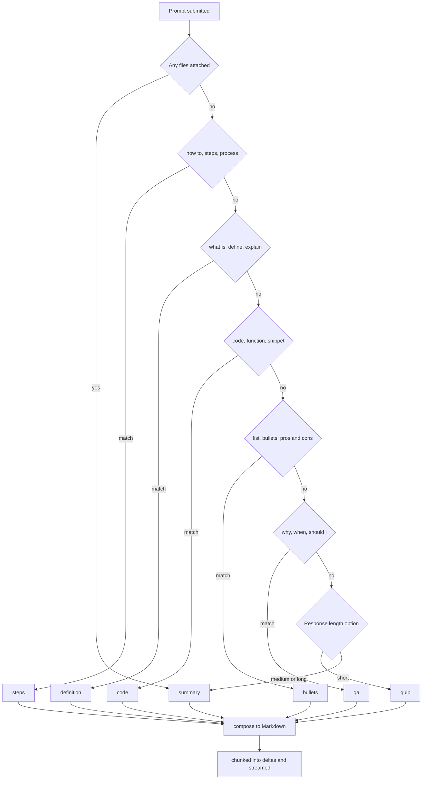

# Streaming chat interface

A single-page chat UI where the interesting part is not the bubbles — it is the turn. A reply
arrives chunk by chunk, you can stop it halfway and keep what arrived, scrolling up to
re-read something does not yank you back down, and none of it needs an API key to try.



The default backend is a scripted assistant that runs inside the tab. It is seeded rather
than random, so the same question with the same settings produces the same answer every
time — which is what makes the screenshots above reproducible and the test suite
deterministic. **No model was called to produce anything in this repository.** Every reply
you see was composed by `src/lib/script/composer.ts`.

## The details a chat UI is actually judged on

| Behaviour                         | Where it lives                             | What it does                                                                                                                    |
| --------------------------------- | ------------------------------------------ | ------------------------------------------------------------------------------------------------------------------------------- |
| Token-by-token rendering          | `src/lib/providers/scriptedProvider.ts:52` | The provider is an `AsyncIterable`, so text paints as it arrives instead of after a spinner.                                    |
| Stop mid-answer                   | `src/lib/chat/useChat.ts:92`               | One `AbortController` per turn. Partial text stays, marked _stopped_.                                                           |
| Late chunks ignored               | `src/lib/chat/turnMachine.ts:95`           | A delta that lands after a cancel is dropped by the reducer, so a stopped answer cannot resurrect itself.                       |
| Scroll anchoring                  | `src/lib/chat/useStickToBottom.ts:75`      | Auto-scroll happens **only** if you were already at the bottom. Otherwise a _Jump to latest_ pill appears.                      |
| Enter vs Shift+Enter              | `src/components/MessageComposer.tsx:89`    | Enter sends, Shift+Enter breaks the line — and `nativeEvent.isComposing` suppresses both while an IME candidate window is open. |
| Escape cancels                    | `src/components/MessageComposer.tsx:94`    | Interrupting never requires the mouse.                                                                                          |
| Input stays live while streaming  | `src/components/MessageComposer.tsx:194`   | The textarea is never disabled. The _send action_ is gated and becomes **Stop**.                                                |
| Markdown is escaped, not injected | `src/components/MarkdownRenderer.tsx`      | No `rehype-raw`, no `dangerouslySetInnerHTML`, and `javascript:` hrefs are stripped in `src/lib/markdown.ts:19`.                |

The scroll rule and the IME rule are the two that are easiest to get wrong and hardest to
notice, so both have tests: `src/lib/chat/useStickToBottom.test.ts` and the
_"does not send on Enter while an IME composition is open"_ case in
`src/components/MessageComposer.test.tsx`.

## The life of a turn

A boolean `isTyping` flag cannot say _"the answer started arriving and then the user stopped
it"_, which is why partial text and failure states are where naive chat UIs fall apart. The
conversation is a reducer (`src/lib/chat/turnMachine.ts`), and every arrow below is a test in
`src/lib/chat/turnMachine.test.ts`.



`Awaiting` and `Streaming` are deliberately separate: the first renders typing dots, the
second renders text with a blinking caret. Collapsing them is what makes a chat feel frozen
for the first second.

## Swapping the backend

Everything the UI needs from a model sits behind one interface in
`src/lib/providers/types.ts`:

```ts
interface ChatProvider {
  readonly id: string;
  readonly label: string;
  readonly offline: boolean;
  stream(request: ChatTurnRequest, signal: AbortSignal): AsyncIterable<ChatDelta>;
}
```

Two implementations ship:

- **`scriptedProvider`** — the default. Composes Markdown locally and yields it in
  four-token chunks with a configurable pause. Needs no network and no account.
- **`httpProvider`** — posts to `POST {base}/chat` and parses a `text/event-stream`
  response (`{"delta":"..."}` per `data:` line, ending at `[DONE]`). That is the
  OpenAI-compatible shape most proxies already speak.

`createProvider()` in `src/lib/providers/index.ts` picks between them from `VITE_CHAT_PROVIDER`.
A third backend is one module plus one `case`.

### There is no API key option, on purpose

Vite substitutes every `VITE_`-prefixed variable into the JavaScript it ships, so a model
key set that way is readable by anyone who opens devtools. `httpProvider` therefore takes a
base URL and nothing else: the credential belongs to _your_ proxy, which authenticates the
browser session (`credentials: "include"`) and holds the key server-side.

`findLeakedSecrets()` in `src/config.ts:48` scans the environment at start-up and warns if
anything matching `API_KEY`, `SECRET`, `TOKEN`, `PASSWORD` or `CREDENTIAL` made it into the
bundle. `.env.example` documents every variable the app reads.

## How the scripted answer is chosen



The options panel is not decoration — each control is wired to something the composer does.
Routing runs first, as an ordered rule list in `src/lib/script/styleRouter.ts`; the first
rule that matches wins, which is why _"how to write a function"_ is `steps` and not `code`.



Once the shape is picked, the remaining options change the text:

| Option          | Effect on the scripted answer                                                                  |
| --------------- | ---------------------------------------------------------------------------------------------- |
| Response length | Which sections are emitted, and the fallback shape when no keyword matches                     |
| Tone            | The opening sentence, from a per-tone pool                                                     |
| Reading level   | The depth qualifier that follows the opener                                                    |
| Temperature     | How wide the phrasing pool is. At `0` exactly one variant is reachable; at `1` all of them are |
| Include outline | Appends a key-points list to prose shapes only                                                 |
| Model           | Named in the trailer, so the transcript records which setting produced the text                |

Temperature is the one worth calling out: it does not add randomness, it widens a
deterministic window (`variantWindow` in `src/lib/script/composer.ts:22`). Given the same
prompt and the same settings, the output is byte-identical.

## Running it

```bash
npm install
npm run dev          # http://localhost:5173
```

No environment file is needed — the local provider is the default.

| Command             | What it does                                                       |
| ------------------- | ------------------------------------------------------------------ |
| `npm run dev`       | Vite dev server on port 5173                                       |
| `npm run build`     | Type-checks with `tsc -b`, then builds to `dist/`                  |
| `npm run preview`   | Serves the production build                                        |
| `npm test`          | Runs the suite once (`test:watch` and `test:coverage` also exist)  |
| `npm run lint`      | ESLint, including `no-magic-numbers` and `consistent-type-imports` |
| `npm run format`    | Prettier over the repo                                             |
| `npm run typecheck` | `tsc -b --force` on its own                                        |

Requires Node 20 or newer.

## Tests

```
$ npm test
Test Files  16 passed (16)
     Tests  186 passed (186)
```

The suite is Vitest plus Testing Library on jsdom. It is weighted towards the logic that is
easy to break and invisible when broken:

- **The turn reducer** — every transition in the diagram above, including the late-delta and
  double-send guards.
- **Cancellation** — `src/App.test.tsx` starts a stream, clicks **Stop**, and then asserts
  that the chunks which were still queued never appear.
- **Markdown safety** — `<script>`, `<iframe>`, `onerror=` and `javascript:` links each have
  a regression test in `src/components/MarkdownRenderer.test.tsx`.
- **Keyboard** — Enter, Shift+Enter, Escape, and the IME composition guard.
- **SSE parsing** — `src/lib/providers/httpProvider.test.ts` splits the response body
  mid-event to prove the parser buffers across reads.
- **Determinism** — the seeded generator, the style router and the composer.
- **Storage** — corrupt payloads and a throwing `localStorage`, as private browsing gives
  you, both degrade to an empty session rather than a blank screen.

## Containers

`Dockerfile` is a two-stage build: Node 22 runs `npm ci` and `npm run build`, then nginx
serves the static output on **port 8080** as the unprivileged `nginx` user, with every
writable path redirected under `/tmp`. `docker-compose.yml` runs it `read_only` with
`cap_drop: ALL`, `no-new-privileges`, and a healthcheck against `/healthz`.

```bash
docker compose up --build
```

**Honest status:** `docker compose config` parses cleanly. The image has **not** been built
or booted — Docker Desktop was off on the machine this was prepared on, so treat build and
boot as unverified.

## Where the code lives

```
src/
├── config.ts             Every env var, plus the leaked-secret scan
├── types/                Message, ChatOptions, AttachmentMeta, MessageStatus
├── lib/
│   ├── providers/        The ChatProvider port, its two adapters, the registry
│   ├── script/           styleRouter (keyword rules) + composer (shape -> Markdown)
│   ├── chat/             turnMachine reducer, useChat, useStickToBottom
│   ├── attachments.ts    Limit checks that return reasons, not alert() dialogs
│   ├── session.ts        localStorage persistence, failure-tolerant
│   ├── transcript.ts     Conversation -> Markdown export
│   ├── markdown.ts       href sanitising and fence extraction
│   └── rng.ts            FNV-1a + mulberry32
└── components/           Shell, list, bubble, composer, options, ui primitives
```

Styling is Tailwind v4, themed from the `@theme` block at the top of `src/index.css` — there
is no `tailwind.config.js`, because v4 does not read one.

## What this is not

- **There is no server.** Attachments are named to the provider but their bytes never leave
  the tab; nothing is uploaded, parsed or stored.
- **The model names in the options panel are labels.** Selecting _Claude 3_ changes one line
  of the scripted trailer, not which model answers, because no model answers.
- **History is per-browser, single-thread.** The transcript lives in `localStorage` under one
  key, so it does not follow you to another device.
- **Streaming is one-way.** No tool calling, no function results, no editing a sent message.
